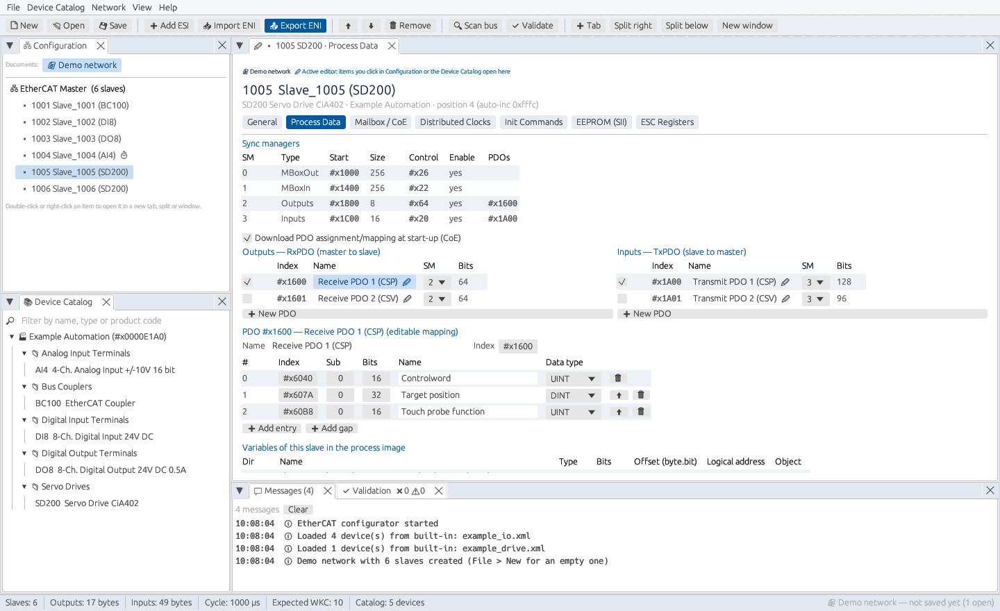
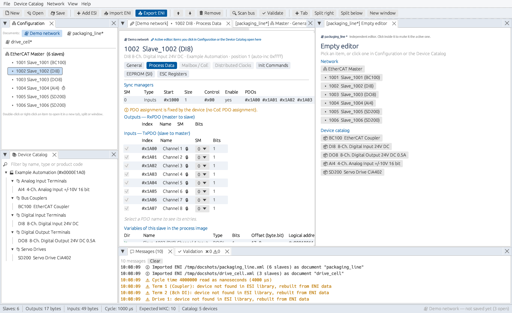

# EtherCAT Configurator

[](https://github.com/brukg/ecat-configurator/actions/workflows/ci.yml)

A desktop tool for building EtherCAT® network configurations. Load the ESI device
description files (ETG.2000) from your device vendors, assemble the network,
adjust process data, start-up parameters and distributed clocks, and export an
ENI network information file (ETG.2100) for your EtherCAT master.



## Features

- **Device catalog:** load ESI files or whole folders, several at once, and search
  them by name, type or product code.
- **Network editor:** add, order and connect devices (ports A–D), set station
  addresses and start-up identity checks. With junctions, the list follows the real
  bus order (ports D, B, C), so auto-increment addresses match the wiring. A bus scan
  rebuilds the wiring from the slaves' port status.
- **Modular devices:** ESI slots and modules (modular I/O stations, multi-axis
  drives). Pick a module per slot; PDO and object indices are shifted per slot, and
  the module list (0xF030) is downloaded at start-up.
- **Process data:** sync managers, PDO assignment with Exclude/Mandatory rules,
  editable PDO mapping, and a live process image with byte/bit offsets.
- **CoE start-up commands:** generated PDO assignment/mapping SDOs plus your own
  SDO downloads per state transition.
- **Object dictionary:** read from the ESI. Pick start-up parameters and PDO entries
  by name, type values as numbers instead of hex, and get warnings for read-only
  objects, wrong sizes or unknown objects.
- **SoE and EoE:** SoE start-up IDN writes for servo drives (S-0-…/P-0-…), and EoE
  IP settings (MAC, IP, subnet, gateway, DNS) sent to each EoE slave.
- **Distributed clocks:** operation modes, SYNC0/SYNC1 cycle and shift times,
  and the reference clock.
- **ENI export and import:** all EtherCAT init commands, cyclic frames and the
  process image. Large process images are split over several frames, each with its
  own expected working counter. Several cyclic tasks with different cycle times
  (e.g. a fast motion task next to slow I/O) each get their own frames. Imported files can be edited and exported again.
- **Embedded targets:** process image as a C header or CSV, and slave EEPROM (SII)
  images as `.bin` or Intel HEX.
- **Online:** scan a real bus on Linux and compare it with the configuration, or
  create a configuration from the scan. Commission single slaves: INIT/PREOP/BOOT,
  AL status code and error counters, CoE SDO read/write, EEPROM read and write, and
  firmware download over FoE.
- **Validation:** address clashes, conflicting PDOs, sync manager sizes, frame
  size, DC settings and more.
- **Hot connect:** mark groups of slaves that may be missing or plugged in while
  running; they are identified by the head's station alias (also written into the
  generated EEPROM image).
- **Undo/redo and copy/paste:** per-document undo history (Ctrl+Z / Ctrl+Y). Cut, copy,
  paste and duplicate slaves, also between documents and between running copies.
- **Documents:** open several ENI or project files at the same time. Each one is
  an independent document.
- **Workspace:** dockable tabs, side-by-side or stacked splits, floating panels and
  separate windows, each showing its own device and page.



## Install

### Debian / Ubuntu package

Download the `.deb` from the [Releases](https://github.com/brukg/ecat-configurator/releases)
page, or build it yourself from a clone with `packaging/build-deb.sh` (see
[Building the Debian package](#building-the-debian-package)). Then install it:

```sh
sudo apt install ./ecat-configurator_<version>_amd64.deb
```

Start **EtherCAT Configurator** from the application menu, or run
`ecat-configurator` in a terminal. The released package is built on Ubuntu 24.04,
so it needs Ubuntu 24.04 or newer or Debian 13 or newer. On older systems, build
from source.

### Windows and macOS

Every push is built and tested on Linux, Windows and macOS. Ready-made packages
can be downloaded from the latest successful
[CI run](https://github.com/brukg/ecat-configurator/actions/workflows/ci.yml)
under *Artifacts*:

- **package-Windows**: `EtherCAT-Configurator-<version>-windows.zip`. Unzip it and
  start `ecat-configurator.exe`; samples and the user guide are included.
- **package-macOS**: `EtherCAT-Configurator-<version>-macos.zip` with
  *EtherCAT Configurator.app*. It is not signed, so open it the first time with
  right-click › *Open*.
- **package-Linux**: the Debian package.

The packages are built by `packaging/build-deb.sh`, `packaging/build-macos-app.sh`
and `packaging/build-windows-zip.sh`. The live bus scan is only available on Linux; everything
else works the same on all three systems.

### Build from source

You need [Rust](https://rustup.rs) (stable). Windows and macOS need nothing else.
On Linux, also install the GTK 3 development files for the file dialogs:

```sh
sudo apt install build-essential libgtk-3-dev libxkbcommon-dev   # Debian/Ubuntu
git clone https://github.com/brukg/ecat-configurator.git
cd ecat-configurator
cargo build --release
./target/release/ecat-configurator
```

## Quick start

1. **Load your devices:** *Device Catalog › Add ESI files…* (or *Add ESI folder…*).
   The catalog remembers these files for the next start. Two example devices are
   built in, so you can try the program straight away.
2. **Create a network:** *File › New configuration*, then double-click devices in
   the catalog to add them in bus order (after the selected device).
3. **Configure each device:** click it in the *Configuration* tree. Its editor shows
   the pages General, Process Data, Mailbox/CoE, Distributed Clocks,
   Init Commands, EEPROM and ESC Registers.
4. **Check:** the *Validation* tab lists errors and warnings. Click one to jump to
   the device.
5. **Export:** *File › Export ENI…* (Ctrl+E) writes the ENI file for your master.
   *File › Save project* (Ctrl+S) keeps the editable project (`.ecproj`).

To edit an existing network, use *File › Import ENI…* or drop the ENI file onto the
window.

The [User Guide](docs/USER_GUIDE.md) explains every screen and option.

## Command line

```text
ecat-configurator [options] [files…]

  files…                    ENI, ESI or .ecproj files to open (each ENI/project as its own document)
  --esi <file|folder>       load ESI files into the catalog (repeatable)
  --project <file.ecproj>   open a configuration project
  --eni <file.xml>          import an ENI file
  --export-eni <out.xml>    write the ENI and exit (no window)
  --export-header <out.h>   write the process image C header and exit
  --screenshot <file.png>   draw the UI off-screen, save a picture and exit
  --help                    show this text
```

Example of generating files in a build pipeline, with no window:

```sh
ecat-configurator --esi vendor_esi/ --project line1.ecproj --export-eni line1_eni.xml --export-header line1_pi.h
```

## Live bus scan

The scan sends raw EtherCAT frames on the selected network adapter (*Master ›
Online / Scan*). Linux needs the `CAP_NET_RAW` capability for this. The Debian
package grants it automatically. When running a self-built binary:

```sh
sudo setcap cap_net_raw+ep ./target/release/ecat-configurator
```

## Building the Debian package

```sh
packaging/build-deb.sh
# result: dist/ecat-configurator_<version>_<arch>.deb
DEB_MAINTAINER="Your Name <you@example.com>" packaging/build-deb.sh   # set the maintainer field
```

## Development

```sh
cargo test             # unit tests, including an ENI export → import → export round trip
cargo fmt              # formatting (rustfmt.toml)
cargo build            # must build without warnings
```

| Path | Contents |
|------|----------|
| `src/esi.rs` | ESI model and parser |
| `src/model.rs` | network model, process image layout, init commands, validation |
| `src/eni.rs` | ENI writer and reader |
| `src/sii.rs` | SII / EEPROM image generator |
| `src/scan.rs` | raw-socket bus scan (Linux) |
| `src/export.rs` | C header and CSV export |
| `src/ui.rs` | user interface: documents, docking workspace, editors |
| `src/offscreen.rs` | off-screen rendering for `--screenshot` |
| `samples/` | example ESI files built into the program |
| `packaging/` | Debian packaging |
| `docs/` | user guide and screenshots |

Planned work is listed in [ROADMAP.md](ROADMAP.md). Bug reports and pull requests are welcome. Please include the ESI/ENI file
(or a reduced version of it) that shows the problem.

## License

[MIT](LICENSE)

EtherCAT® is a registered trademark and patented technology, licensed by Beckhoff
Automation GmbH, Germany. This project is not affiliated with Beckhoff or the
EtherCAT Technology Group.
