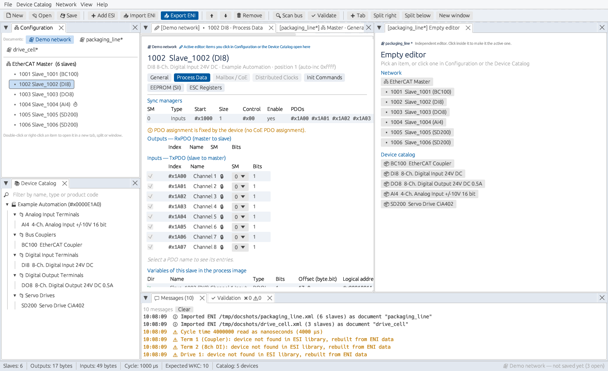
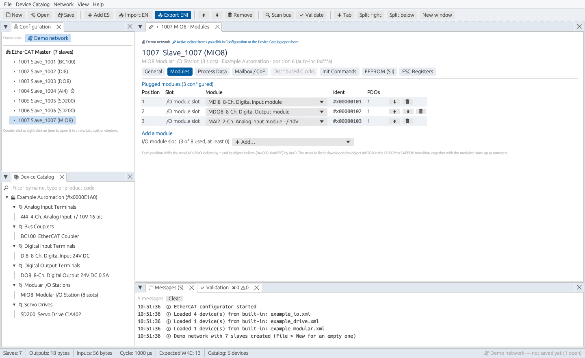
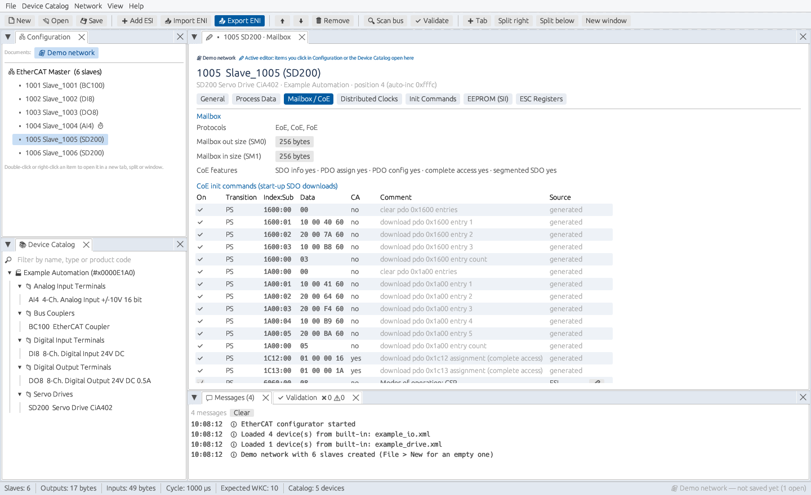
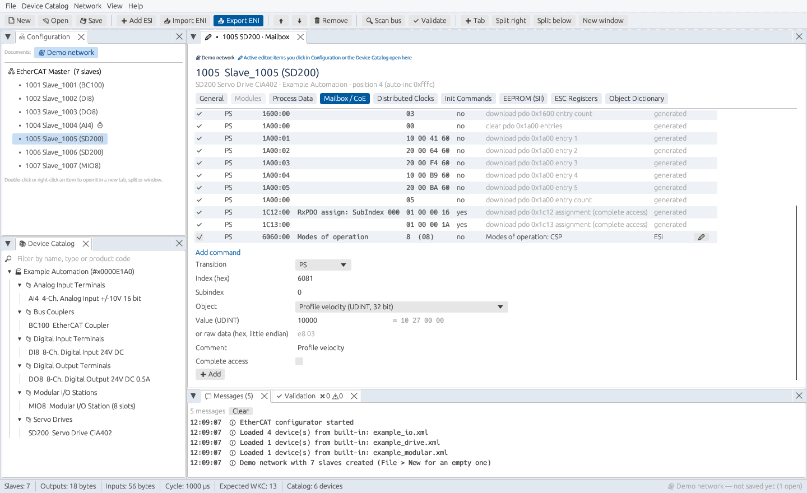
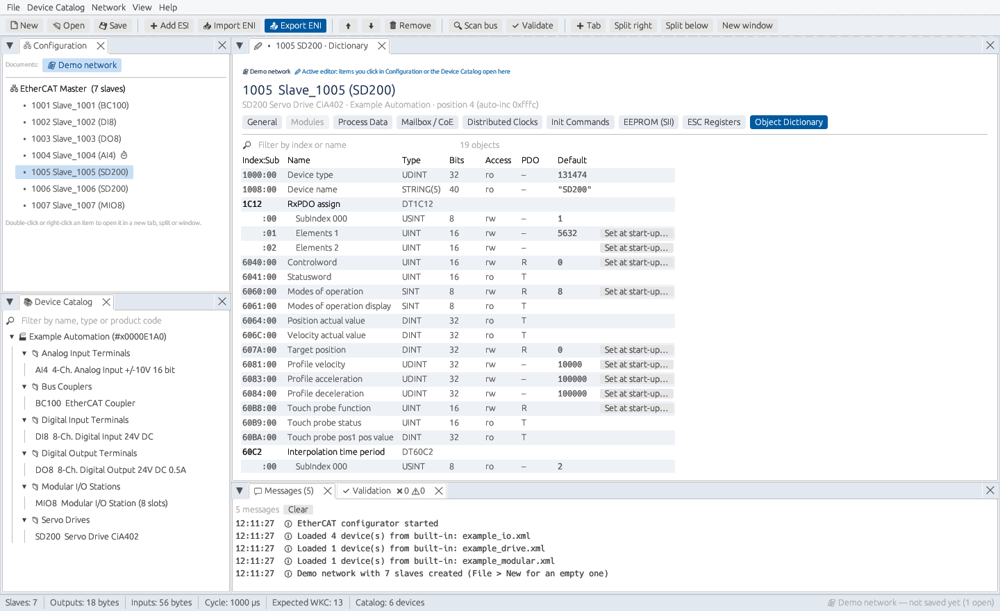
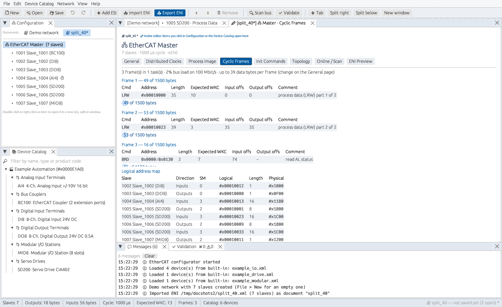

# User Guide

This guide walks through every part of EtherCAT Configurator. For installing and
a short overview, see the [README](../README.md).

- [The window](#the-window)
- [Documents](#documents)
- [Workspace: tabs, splits and windows](#workspace-tabs-splits-and-windows)
- [Device catalog (ESI files)](#device-catalog-esi-files)
- [Building the network](#building-the-network)
- [Slave pages](#slave-pages)
- [Master pages](#master-pages)
- [Validation](#validation)
- [Files: ENI, projects and exports](#files-eni-projects-and-exports)
- [Live bus scan](#live-bus-scan)
- [Keyboard shortcuts](#keyboard-shortcuts)
- [What the generated ENI contains](#what-the-generated-eni-contains)
- [Settings and troubleshooting](#settings-and-troubleshooting)
- [Known limitations](#known-limitations)

## The window

| Area | Purpose |
|------|---------|
| Menu bar | *File*, *Device Catalog*, *Network*, *View*, *Help* |
| Toolbar | New, Open, Save, Add ESI, Import/Export ENI, move/remove device, Scan bus, Validate, and new tabs/splits/windows |
| **Configuration** | open documents, plus the master and slaves of the active document |
| **Device Catalog** | all devices from the loaded ESI files |
| **Editors** | the pages of a master, slave or catalog device |
| **Messages / Validation** | the log, and the problems found in the active configuration |
| Status bar | slave count, image sizes, cycle time, expected working counter, active document |

Every area is a dockable tab: you can move, split, float or close it, and reopen
it from *View*.

## Documents

Each configuration you work on is a **document**. *File › New configuration*,
*Open project*, *Import ENI*, *Open files…* and *Create configuration from scan*
each open a new document. They never replace the one you are working on.

- Open several files at once: the file dialogs accept multi-selection, and you can
  drop files onto the window or pass them on the command line. ENI and project
  files become documents; ESI files go into the catalog.
- The document buttons at the top of the **Configuration** panel switch between
  documents. A `*` marks unsaved changes.
- Editor tabs are labelled with their document, e.g. `[line1] 1002 DI8 · Process Data`.
- To close a document, right-click its button or use *File › Close document*. You
  are asked first if it has unsaved changes.

Documents are completely independent. Editing one never changes another.

## Workspace: tabs, splits and windows

- **Active editor (✏):** items you click in the Configuration tree or the catalog
  open in the active editor. Clicking inside any editor makes it the active one.
- **Toolbar: + Tab / Split right / Split below / New window** open a new, empty
  editor, which becomes active. Pick an item in it, or click one in the tree.
- **Right-click** a device in the tree, the catalog or an editor tab, or
  **double-click** a device, to open it in a new tab, a split, a floating panel or
  its own window.
- **Drag** a tab onto the edge of another pane to split it, onto a tab bar to
  stack it, or outside the dock area to float it.
- Every editor keeps its own device, page, selected PDO and scroll position.
- A separate window has a **Dock back** button that returns it to the main window.
- *View › Reset layout* restores the default arrangement. *View › Close all other
  editors and windows* tidies up. The layout is remembered between sessions.

## Device catalog (ESI files)

- *Device Catalog › Add ESI files…* or *Add ESI folder…* loads ESI XML files. The
  paths are remembered and loaded again at the next start.
- *Reload catalog* reads all remembered files again, and *Forget remembered ESI
  paths* clears the list.
- Use the filter box to search by name, type or product code (hex).
- Click a device to see its details: identity, mailbox protocols, sync managers,
  PDOs, DC modes and EEPROM size. Double-click it, or press *Add to configuration*,
  to append it after the selected slave.
- If two files describe the same vendor/product/revision, the one loaded last wins.
- Example devices are built in: a coupler, digital I/O, analog input, a CiA 402
  servo drive and a modular I/O station with three module types.

## Building the network

- **Add:** double-click a catalog device. It is inserted after the selected slave.
- **Order:** select a slave and use ⬆ / ⬇ (or *Network › Move slave up/down*). The
  list order is the bus order, so the auto-increment address of position *n* is −*n*.
- **Remove:** 🗑 *Remove* or the Delete key.
- **Station addresses** start at 1001 and are unique. *Network › Re-number
  station addresses* renumbers them in bus order.
- **Topology:** on a slave's *General* page, *Connected to* and *port* set the
  upstream device and its port (B, C or D). *Network › Make topology linear*
  resets the chain. *Master › Topology* draws the tree.

### Undo, redo, copy and paste

- **Edit › Undo / Redo** (Ctrl+Z / Ctrl+Y or Ctrl+Shift+Z, and ⟲ ⟳ in the toolbar)
  steps through the changes of the active document. Each document has its own
  history of up to 100 steps. Typing in a field or dragging a value counts as one
  step; every other action (add, remove, move, paste, toggle…) is a step of its own.
  While a text field has focus, Ctrl+Z undoes the typing in that field instead.
- **Cut / Copy / Paste / Duplicate** (Ctrl+X / C / V / D) work on the selected slave
  in the tree, with all its settings: PDOs, modules, start-up commands and DC.
  The copy gets a free station address and is inserted after the selected slave.
  Copied slaves are also placed on the system clipboard, so they can be pasted into
  another document or another running copy of the program.

## Slave pages

### General
Name, station address, serial number, and the upstream device and port. **Identity
check at start-up** chooses which values the master compares with the slave's
EEPROM: vendor ID, product code, revision (equal / equal or higher) and serial
number. **Watchdog** sets the process data watchdog time.

### Modules (modular devices)

Shown for devices whose ESI describes slots, such as modular I/O stations and
multi-axis drives.

- **Plugged modules** lists the slot positions in order. Change a position's module
  with its drop-down, reorder positions with ⬆/⬇, or remove a position with 🗑.
- **Add a module** appends a module for a slot type, up to its maximum count.
- The PDOs of each module are added to *Process Data* as `Slot n <module>: <PDO>`.
  Their PDO indices move by the slot's PDO increment and their object indices
  (0x6000–0xAFFF) move by the slot's index increment for each position.
- At start-up the configurator writes the module ident list to object 0xF030
  (PREOP to SAFEOP, before the PDO assignment), followed by each module's start-up
  parameters, moved to the module's object range.
- Validation reports slot counts outside the ESI minimum/maximum, modules that do
  not fit their slot, and unknown module idents.
- ENI import reads the module list back from 0xF030 and rebuilds the slots, so a
  modular configuration survives export and re-import.

### Process Data
- **Sync managers:** start address, size (computed from the assigned PDOs),
  control byte and the assigned PDOs.
- **RxPDO / TxPDO lists:** tick a PDO to assign it. PDOs listed in another PDO's
  *Exclude* are switched off automatically; mandatory PDOs (🔒) cannot be removed.
  The SM column moves a PDO to another sync manager of the same direction.
- **PDO entries:** click a PDO name to see its entries. PDOs marked ✏ have an
  editable mapping when the device supports CoE PDO configuration: change index,
  subindex, bit length, name or data type, reorder or delete entries, add gaps, or
  create a *New PDO*. With an object dictionary, **From dictionary…** adds an
  entry that may be mapped in this direction, with the right size and type.
- *Download PDO assignment/mapping at start-up* generates the CoE commands
  (0x1C12/0x1C13 and 0x16xx/0x1Axx). If the device has no CoE PDO assignment, the
  assignment is fixed and changing it raises a validation warning.
- **Variables** shows this slave's entries in the process image with byte.bit
  offsets and logical addresses.

### Mailbox / CoE

Shows the mailbox protocols and the mailbox sizes (within the ESI limits), and the
**CoE init commands**:

- *generated* rows come from the PDO settings and are read-only.
- *ESI* rows come from the device description. They can be switched off but not
  deleted.
- *user* rows are your own. Fill in transition, index (hex), subindex and data
  (hex bytes, little-endian, e.g. `e8 03` for 1000), then press **Add**. Use ✏ to
  edit a row and ⬆/⬇ to reorder.
- With an object dictionary, pick the **Object** from the list (searchable) and type
  the **Value** as a number or text. It is converted to the object's type, and the
  resulting bytes are shown next to it. Rows show the object name and the
  decoded value, e.g. `6081:00 Profile velocity · 10000 (10 27 00 00)`.

### Object Dictionary

Shown when the ESI contains a CoE dictionary (`Profile/Dictionary`). It lists
every object and subindex with type, bit size, access (ro/rw/wo), PDO mapping
(R = RxPDO, T = TxPDO) and default value. Records and arrays are expanded into
their entries. Use the filter box to search by index or name.

**Set at start-up…** next to a writable entry opens *Mailbox / CoE* with the
command form already filled in (index, subindex, name and default value).
Change the value and press **Add**.

### Distributed Clocks
Choose the operation mode (from the ESI), make the slave the reference clock, and
set SYNC0/SYNC1 cycle and shift times. Cycle times follow the master cycle and the
ESI factor unless you switch off *from master cycle*.

### Init Commands
The full list of EtherCAT commands the master will run for this slave in each
state transition (IP, PS, SO, OS, SP/OP, PI/SI/OI), with the expected values,
followed by the CoE commands.

### EEPROM (SII)
*Generate from ESI* builds the slave EEPROM content: config area with checksum,
identity, mailbox, and the strings, general, FMMU, sync manager and PDO
categories. Save it as `.bin` or Intel HEX for an EEPROM programmer.

### ESC Registers
The raw bytes written to the sync manager (0x0800+) and FMMU (0x0600+) registers.

## Master pages

| Page | Contents |
|------|----------|
| General | name, network adapter, source/destination MAC, EtherType, cycle time, LRW or LRD+LWR, logical start address, frame size limit, state machine timeouts, image summary |
| Distributed Clocks | enable DC, choose the reference clock, overview of all DC slaves |
| Process Image | every input and output variable with offsets; export as C header or CSV |
| Cyclic Frames | every cyclic frame with its commands (address, length, expected working counter, image offsets), frame usage, wire time and bus load, logical address map |
| Init Commands | the master's broadcast init commands |
| Topology | diagram of the network; click a device to select it |
| Online / Scan | scan the bus and compare it with the configuration |
| ENI Preview | the ENI exactly as it will be exported; copy or export it |

### Large process images

When the process data does not fit into *Max. data per frame* (General page,
1486 bytes at most), it is split into several commands, cutting at slave
boundaries where possible. The commands are then packed into as few frames as
possible. Each command gets its own expected working counter: a slave counts in
every command that covers its data (LRW: +2 for outputs, +1 for inputs). The
AL-status read goes into the last frame that has room.

The ENI contains one `<Frame>` per frame. Importing such an ENI keeps the frame
size, so it is split the same way when exported again. The C header lists every
command (`ECAT_CMDn_FRAME/ADDR/LEN/WKC`) and the frame count.

## Validation

The *Validation* tab checks the active configuration all the time. It looks for:

- duplicate or zero station addresses, and invalid ports;
- mandatory PDOs that are not assigned, and assigned PDOs that exclude each other;
- sync managers above their maximum size, and mailboxes below their minimum;
- frames that need more than half of the cycle time on a 100 Mbit/s wire (it also
  reports, as information, when the process data is split over several frames);
- DC problems: a mode set while DC is off, a SYNC0 cycle of 0, or a reference
  clock without DC support;
- start-up commands that write read-only objects, objects or subindices that are
  not in the dictionary, or data of the wrong size for the object's type.

Errors are marked ❌ and warnings ⚠, also in the tree. Click a message to select
the device. Exporting with errors is possible, but you get a warning first.

## Files: ENI, projects and exports

| Action | Result |
|--------|--------|
| *File › Export ENI…* (Ctrl+E) | ENI XML for your EtherCAT master |
| *File › Import ENI…* | opens an ENI as a new document. Devices are matched with the catalog by vendor/product/revision; unknown devices are rebuilt from the ENI's data and reported in Messages |
| *File › Save project* (Ctrl+S) / *Save project as…* | `.ecproj` (JSON) with everything, including the device descriptions, so it opens without the ESI files |
| *File › Open project…* (Ctrl+O) | opens `.ecproj` files as new documents |
| *File › Open files…* | any mix of ENI, ESI and project files |
| *File › Export process image as C header / CSV* | offsets and sizes for firmware or PLC code |

Exporting an ENI, importing it again and exporting once more gives an identical file.

## Live bus scan

1. Connect the computer's network adapter to the first EtherCAT slave.
2. Open *Master › Online / Scan*, choose the adapter and press **Scan bus**.
3. The table lists every slave found (vendor, product, revision, serial number, AL
   state) and compares it with the configuration: ✔ matches, ⚠ different revision
   or not configured, ❌ a different device or missing.
4. **Create configuration from scan** opens a new document with the devices found
   (matched with the catalog). **Copy serial numbers** writes the scanned serial
   numbers into the configuration.

The scan is available on Linux and needs `CAP_NET_RAW`; see the README.

## Keyboard shortcuts

| Keys | Action |
|------|--------|
| Ctrl+O | open project(s) |
| Ctrl+S | save the active document |
| Ctrl+E | export ENI |
| Delete | remove the selected slave (when not typing in a field) |
| Ctrl+Z / Ctrl+Y | undo / redo (Ctrl+Shift+Z also redoes) |
| Ctrl+X / Ctrl+C / Ctrl+V | cut / copy / paste the selected slave |
| Ctrl+D | duplicate the selected slave |

## What the generated ENI contains

- **Master:** source/destination MAC, EtherType, and broadcast init commands
  (slave count, INIT request, clearing addresses/FMMUs/SMs, DC preparation).
- **Per slave:** identity, process data (sync managers, assigned and available
  PDOs), mailbox and CoE init commands, EtherCAT init commands, the previous port,
  and DC settings.
- **Cyclic:** LRW commands (or LWR + LRD) covering all process data, split over
  several frames when needed, plus a BRD of the AL status. Outputs come first in the logical image and inputs follow them.
- **Process image:** every variable with bit size and bit offset.

## Settings and troubleshooting

- Settings (remembered ESI paths, window layout) are stored in
  `~/.config/ecat-configurator/settings.json`. Delete the file to start fresh.
- If the program ever stops unexpectedly, the reason is written to
  `~/.config/ecat-configurator/crash.log`. Please attach it to bug reports.
- *Scan failed: permission denied:* grant `CAP_NET_RAW` (see the README) or run as root.
- *Device not found in ESI library* after an ENI import: load the vendor's ESI
  file, then import again to get the full PDO lists and DC modes.
- ESI files in ISO-8859-1, UTF-8 or UTF-16 are all accepted.

## Known limitations

- All process data runs at one cycle time; separate tasks with different cycle
  times are not supported yet.
- Hot-connect groups and redundancy are not configured.
- The live bus scan is available on Linux only.
